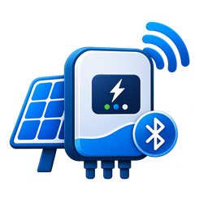

# Deye BLE for Home Assistant



A read-only Home Assistant integration for **Deye solar inverters**. It talks locally to the inverter's Wi-Fi/BLE logger stick over Bluetooth Low Energy. No cloud account is needed, only a Bluetooth adapter or an ESPHome Bluetooth proxy within range of the stick.

> Unofficial project, not affiliated with Deye. It has been tested only on the inverter listed under [Supported hardware](#supported-hardware).

## Features

- PV1 / PV2 voltage, current and power, plus total PV power
- Grid voltage, current, frequency, output power and power factor
- Daily and total generation energy
- Inverter state, warning and fault codes, with a description for each active fault
- Radiator (IGBT) temperature, firmware versions, rated power
- Optional meter power and load, import and export energy (needs a Deye meter, disabled by default)
- **BLE Connection** switch, **Automatic Polling** switch and **Poll Now** button
- Values survive a Home Assistant restart, so energy totals are still shown at night
- Downloadable, redacted diagnostics

## Requirements

- Home Assistant 2025.8.0 or newer with the **Bluetooth** integration working. A local adapter or an ESPHome Bluetooth proxy works; it must be *connectable*.
- The logger stick must be in range. Its Bluetooth name is `AP_` followed by the logger serial number.
- No pairing, password or encryption is needed on the tested stick.

## Installation

### HACS (custom repository)

1. In HACS open the three-dot menu and choose **Custom repositories**.
2. Add `https://github.com/mahipat99/Deye-BLE` with category **Integration**.
3. Search for **Deye BLE**, download it, and restart Home Assistant.
4. Go to **Settings → Devices & services**. A discovered logger shows up automatically; otherwise choose **Add integration → Deye BLE**.

### Manual

Copy `custom_components/deye_ble` into `config/custom_components/`, restart Home Assistant and add the integration as above.

When you add the integration it connects once to confirm that the Deye Bluetooth service (`FEE7`) and characteristic (`FED4`) are present.

**Only one Bluetooth client can talk to the stick at a time.** Close the Deye app and nRF Connect before adding or using the integration.

## Controls

| Entity | What it does |
|---|---|
| **BLE Connection** (switch) | Master switch. OFF disconnects immediately, turns Automatic Polling OFF and blocks all Bluetooth use, including Poll Now. ON only *allows* Bluetooth; it does not turn polling back on. |
| **Automatic Polling** (switch) | OFF stops scheduled reads. Poll Now still works while BLE Connection is ON. In Always Connected mode the link stays open. Turning it ON while BLE Connection is OFF is refused. |
| **Poll Now** (button) | Reads every register block once. Unavailable while BLE Connection is OFF, and refused during a cloud upload break. |
| **BLE Connected** (diagnostic) | Whether a Bluetooth link is open right now. |

Both switches keep their state across restarts and stay available while the inverter is asleep.

## Configuration

Open the integration and choose **Configure**.

| Setting | Default | Meaning |
|---|---|---|
| Connection mode | Connect on Demand | **Connect on Demand** connects for each poll and disconnects afterwards. **Always Connected** keeps the link open. |
| Polling interval | 60 s | Time between automatic polls, 10 to 300 s. |
| Cloud upload break | 0 (off) | *Always Connected only.* Every this many minutes (0 to 1440) the link is released for 60 seconds so the logger can upload to the Deye cloud. |

In Connect on Demand mode the link is already free between polls, so the cloud upload break is not needed. While a break is running, scheduled polls are skipped and Poll Now is refused.

## When the inverter is asleep

The inverter and its stick power down at night. After three poll cycles in a row with no answer (the first one, if nothing has answered since Home Assistant started) the integration treats the inverter as offline:

| Values | While offline |
|---|---|
| Daily and total energy (generation, load, import, export), rated power, firmware, serial | Keep their last known value, also across restarts |
| PV voltage, current and power, grid current, grid output power | Show 0 |
| Grid voltage, frequency, power factor, radiator temperature, meter power and load power | Unavailable |
| Inverter State | **Offline** |

Polling also slows to every 5 minutes (or your interval if it is longer) while the inverter is offline, in **Standby** or **Turn Off**. It returns to your interval as soon as the inverter reports another state. Expect up to 5 minutes of delay in picking up the inverter at sunrise.

A Bluetooth outage in daylight looks the same as an asleep inverter, so PV power shows 0 until the link is back.

## How polling works

- Registers are read one block at a time with 0.6 s between requests.
- Serial, firmware, rated power, clock and meter detection are slow data: read on the first poll and then every 10 minutes. **Poll Now** reads everything.
- If no meter is connected, the meter block is skipped. Meter sensors are disabled by default; enable them in the entity settings if you have a Chint or Eastron meter.
- If a poll gets no answer to its first request, the cycle stops instead of waiting for every block to time out.

## Entities

- **Sensors:** PV1/PV2 voltage, current and power, PV power, grid values, power factor, daily/total generation, radiator temperature, inverter state, fault and warning codes.
- **Diagnostic:** warning and fault registers, firmware versions, rated power, meter type, BLE RSSI, BLE Connected.
- **Disabled by default:** serial number, protocol version, safety type, MPPT / phase configuration, inverter clock, last successful update, and the meter sensors.

Notes:

- PV power is not a register on the inverter; it is calculated as voltage × current.
- This model is single-phase, so only the single-phase radiator temperature register (`0x005A`) is read.
- The `SUN-6K-G05P1-EU-CM2` profile is single-phase with 2 MPPT trackers. PV1 uses registers `0x006D`/`0x006E` and PV2 uses `0x006F`/`0x0070`, each scaled by 0.1.
- Daily and total **load** energy come from the separate meter block and are not the same as generation energy.
- Warnings are decoded as `W01`–`W32` (registers `0x0065`–`0x0066`) and faults as `F01`–`F64` (`0x0067`–`0x006A`), numbered sequentially. The bit order inside each register (lowest bit first) is assumed and has not yet been checked against a real fault. Warning descriptions are not available, so warnings show as codes only.
- The **Fault Codes** sensor lists active codes. Its attributes add a description and, where known, advice from Deye's published single-phase fault table. That table has **not** been verified against this inverter, and some entries may not apply to it. The raw fault-register sensors are there for checking.

## Diagnostics and logging

Use the device's **Download diagnostics** action. The Bluetooth address, logger name and serial numbers are redacted. For more detail, enable debug logging (commands, raw notifications, per-block results) and review the logs before sharing them:

```yaml
logger:
  default: warning
  logs:
    custom_components.deye_ble: debug
```

## Protocol summary

Observed on real hardware. See `protocol.py`.

- GATT service `0xFEE7`, characteristic `0xFED4` (notify + write without response).
- Request: `AT+INVDATA=<len>,<Modbus RTU frame as uppercase hex>\n`, slave `01`, function `03`, CRC16 low byte first. `<len>` is `8` for reads.
- Reply: notification `+ok=<Modbus response hex>0000`. The trailing `0000` is padding. Errors start with `+err`.
- Registers are big-endian 16-bit words. 32-bit values store the **low word first**.
- Example: reading registers 3 to 7 sends `AT+INVDATA=8,01030003000575C9`.

## Supported hardware

| Inverter model | Phase | MPPT | Status |
|---|---:|---:|---|
| SUN-6K-G05P1-EU-CM2 | Single-phase | 2 | Tested |

Other models need their own confirmed register map and live test data. Reports and diagnostics from other Deye models are welcome at the [issue tracker](https://github.com/mahipat99/Deye-BLE/issues).

## Limitations

- Read-only. The integration never sends write or provisioning commands (Wi-Fi setup, data mode, register writes).
- Only the model listed above is supported.
- One Bluetooth connection at a time, so the Deye app and this integration cannot be used simultaneously.
- Meter values only exist with a Chint or Eastron meter connected.

## Development

The protocol tests need no Home Assistant installation: `python -m unittest discover -s tests`. Keep model-specific register maps separate in `models.py` and do not reuse single-phase maps for three-phase, hybrid or microinverter models.

## License

Released under the [MIT License](LICENSE).
